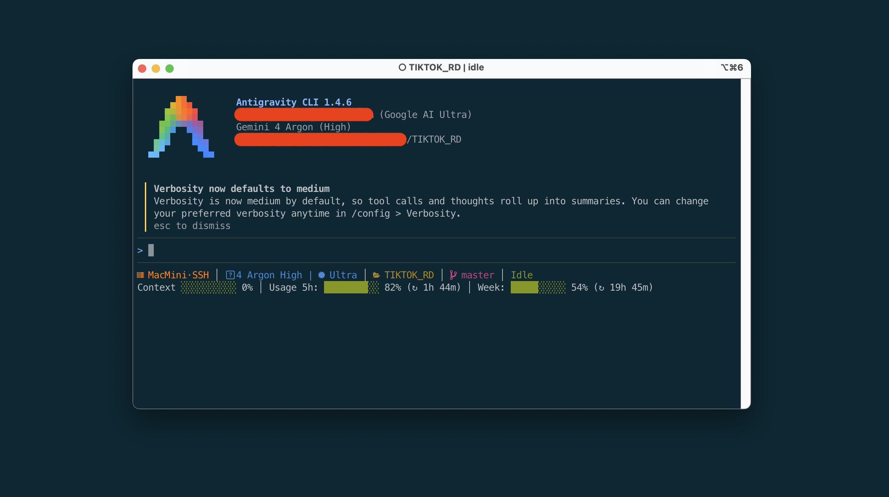

# agy-statusline (`agy-hud`)

> **High-density Status-Line HUD, Pure-Bash Statusline & Dynamic Terminal / tmux Title Suite for Antigravity CLI (`agy`).**

[](LICENSE)
[](package.json)
[](package.json)

🌐 **Languages:** **English** | [🇻🇳 Tiếng Việt (`README.vi.md`)](README.vi.md)



---

## 1. Overview

**`agy-statusline`** is an open-source, zero-dependency status-line and terminal/tmux title suite engineered for **Antigravity CLI (`agy`)**. It provides two interchangeable status-line engines plus an intelligent terminal and `tmux` window/pane title synchronizer:

1. **`agy-hud` (Node.js HUD Plugin — Default)**:
   - Single-line or multi-line HUD with customizable segments.
   - **Host & Connection Detection (`host` segment)**: Automatically detects hardware (`MacMini`, `Laptop`, or hostname) and connection context (`Local` vs `SSH`, including active `tmux` client ancestry) — eliminating multi-machine confusion when remoting from a Laptop into a Mac mini.
   - **Real-Time `/rename` Session Title & `tmux` Sync (`session` segment)**: Instant `/rename` reactivity via `history.jsonl` (matching `conversationId` or `workspace` on brand-new sessions before the first prompt), `conversation_title` payload, and SQLite (`~/.gemini/antigravity-cli/conversation_summaries.db`). Automatically synchronizes both the enclosing `tmux` pane title (`tmux select-pane -T`) and window name (`tmux rename-window`).
   - **Git Workspace Intelligence (`workspace` segment)**: Fast, zero-subprocess `.git/HEAD` branch resolver supporting standard repositories, worktrees, and submodules.
   - **Context Window Bar (`context` segment)**: Visual progress bar with color-coded warning/critical thresholds.
   - **Dual-Window Quota (`quota` segment)**: Tracks `5h` and `Week` usage windows with countdown timers and a local loopback probe against the active Antigravity language server (`GetUserStatus`).
   - **Responsive Width Budgeting**: Automatically compacts segments on narrower terminals so the HUD never wraps or corrupts the prompt.

2. **`scripts/statusline.sh` (Pure-Bash Statusline — Alternative)**:
   - Lightweight Bash + `jq` status line with three responsive breakpoints (**Wide ≥120 cols**, **Medium 80–119 cols**, **Narrow <80 cols**).
   - Displays `[Host·Mode]`, Agent State (`READY`, `THINKING`, `WORKING`, `TOOL`), Session Title, Git branch, Sandbox status, 15-segment fine-grain Unicode Context meter, Artifacts, Subagents, Background Tasks, and Model badge, while also synchronizing `tmux` window/pane titles on `/rename`.

3. **`scripts/title.sh` (Dynamic iTerm2 / Terminal / tmux Title Engine)**:
   - Emits OSC 1 (tab title), OSC 2 (window title), and iTerm2 User Variables (OSC 1337 `session_name` / `session_title`) directly to `/dev/tty`.
   - Updates `tmux` pane titles (`tmux select-pane -T`) and window names (`tmux rename-window`) directly via the `tmux` CLI so renames work even when `set-option -g allow-rename off` is configured in `~/.tmux.conf`.

---

## 2. Repository Architecture

```text
agy-statusline/
├── src/                      # Modular CommonJS source code
│   ├── ansi.js               # ANSI styling, visible length, truncation, progress bars
│   ├── config.js             # Configuration loader & defaults
│   ├── gitinfo.js            # Fast Git branch resolver (supports worktrees & submodules)
│   ├── host.js               # Hardware model (MacMini/Laptop) & SSH/Local/tmux detector
│   ├── session.js            # Session title resolver & tmux window/pane synchronizer
│   ├── quota.js              # Dual-window (5h + Week) quota parser & formatter
│   ├── quotaProbe.js         # Local Antigravity LanguageServer GetUserStatus probe
│   ├── statusline.js         # Segment renderer & terminal width-budget manager
│   └── main.js               # CLI router & stdin reader
├── dist/
│   └── agy-hud.js            # Standalone zero-dependency bundle generated by scripts/build.js
├── hooks/
│   └── status-line.sh        # Antigravity CLI plugin hook wrapper
├── scripts/
│   ├── build.js              # Bundler (src/*.js -> dist/agy-hud.js)
│   ├── statusline.sh         # Pure-Bash 3-tier responsive statusline
│   └── title.sh              # Dynamic terminal / iTerm2 / tmux tab & window title script
├── test/
│   ├── agy-hud.test.js       # Unit tests + 10,000-iteration soak/fuzz test suite
│   └── scripts.test.js       # Integration tests for hooks, Bash scripts, and installer
├── config.example.json       # Default configuration template
├── plugin.json               # Antigravity CLI plugin manifest
└── install.sh                # One-command installer (--hud or --bash)
```

---

## 3. Quick Start & Installation

### Prerequisites
- **macOS** or **Linux**
- **Node.js `>= 18`** (for `agy-hud` mode and running tests)
- **`jq`** and **`sqlite3`** (recommended for `scripts/statusline.sh` and `scripts/title.sh`)

### One-Command Install
Clone the repository and run `./install.sh`:

```bash
git clone https://github.com/bond2bill/agy-statusline.git
cd agy-statusline

# Option A (Recommended): Install Node.js HUD plugin + dynamic title.sh
./install.sh --hud

# Option B: Install Pure-Bash statusline.sh + dynamic title.sh
./install.sh --bash
```

What `./install.sh` does automatically:
1. Builds `dist/agy-hud.js` from `src/*.js` and installs the plugin into `~/.gemini/config/plugins/agy-hud/`.
2. Copies `statusline.sh` and `title.sh` into `~/.gemini/antigravity-cli/`.
3. Preserves your existing `~/.gemini/config/plugins/agy-hud/config.json` (or initializes it from `config.example.json` on first install).
4. Updates `~/.gemini/antigravity-cli/settings.json` to wire both `statusLine` and `title` hooks.
5. Automatically upgrades `~/.tmux.conf` (if present) so `tmux` window tabs and pane borders display `agy` session titles alongside Claude Code (`*.*.*`), and reloads the active `tmux` server.

---

## 4. `tmux` Window & Pane Border Integration

When running `agy` inside `tmux`, `agy-statusline` automatically executes `tmux select-pane -t "$TMUX_PANE" -T "● <SessionTitle>"` and `tmux rename-window -t "$TMUX_PANE" "<SessionTitle>"` whenever you run `/rename <SessionTitle>` (even when `set-option -g allow-rename off` is set in `~/.tmux.conf`).

For custom `~/.tmux.conf` status bars and pane borders, use the following format rules (automatically configured by `./install.sh`):

```tmux
setw -g window-status-current-format ' #I:#{?#{m/r:^([0-9]+[.][0-9]+[.][0-9]+|agy)$,#{pane_current_command}},#{s/ [|] .*//:#{s/^[✳●○🏃😴] *//:pane_title}},#W}#F '
setw -g window-status-format ' #I:#{?#{m/r:^([0-9]+[.][0-9]+[.][0-9]+|agy)$,#{pane_current_command}},#{s/ [|] .*//:#{s/^[✳●○🏃😴] *//:pane_title}},#W} '
set -g pane-border-format " Pane: #{pane_index} | #{?#{m/r:^([0-9]+[.][0-9]+[.][0-9]+|agy)$,#{pane_current_command}},#{s/ [|] .*//:#{s/^[✳●○🏃😴] *//:pane_title}} (#{pane_current_command}),#{pane_current_command}} "
set -g set-titles-string "#S#{?#{m/r:^([0-9]+[.][0-9]+[.][0-9]+|agy)$,#{pane_current_command}}, (#{s/ [|] .*//:#{s/^[✳●○🏃😴] *//:pane_title}}),}"
```

---

## 5. Configuration (`~/.gemini/config/plugins/agy-hud/config.json`)

```json
{
  "show_model": true,
  "show_progress_bar": true,
  "multiline": true,
  "color": true,
  "show_git_branch": true,
  "show_cwd": true,
  "show_agent_state": true,
  "show_icons": true,
  "show_session": true,
  "show_host": true,
  "context_value": "percent",
  "usage_value": "remaining"
}
```

### Environment Variables
| Variable | Target | Description |
| :--- | :--- | :--- |
| `AGY_HOST_LABEL` | `agy-hud` & `statusline.sh` | Override hardware label (e.g., `export AGY_HOST_LABEL="MacMini"`). |
| `AGY_HUD_CONFIG` | `agy-hud` | Custom path to `config.json`. |
| `AGY_HUD_DEBUG=1` | `hooks/status-line.sh` | Saves the latest stdin JSON payload from `agy` to `debug/last_payload.json`. |
| `AGY_TITLE_STYLE` | `title.sh` & `session.js` | `dot` (default: `●` / `○`) or `emoji` (`🏃` / `😴`). |
| `AGY_TMUX_NO_SYNC=1` | `agy-hud` & `statusline.sh` | Disable automatic `tmux` window/pane renaming. |

---

## 6. Building & Testing (Unit + 10,000-Iteration Soak Tests)

```bash
# Rebuild dist/agy-hud.js from modular src/*.js
npm run build

# Run all unit & shell integration tests
npm test

# Run 10,000-iteration randomized soak & fuzz test suite
npm run soak
```

---

## License

Released under the [MIT License](LICENSE). Copyright © [bond2bill](https://github.com/bond2bill).
