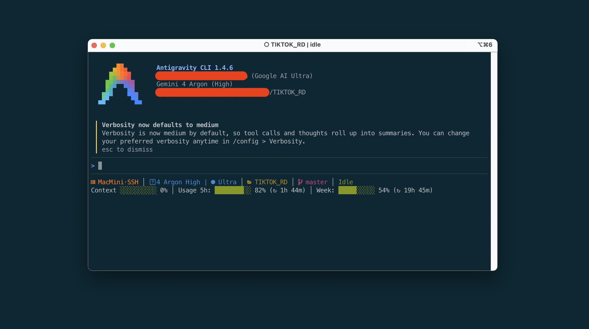

# agy-statusline (`agy-hud`) — Tài Liệu Tiếng Việt

> **Bộ công cụ Status-Line HUD đa tầng, Pure-Bash Statusline và Terminal / `tmux` Fleet Monitor thống nhất cho cả Antigravity CLI (`agy`) và Claude Code CLI (`claude`).**

🌐 **Languages / Ngôn ngữ:** [🇬🇧 English (`README.md`)](README.md) | **🇻🇳 Tiếng Việt**



---

## 1. Tính năng nổi bật

### 1.1. Nhận diện Máy chủ & Kết nối (`MacMini·SSH` vs `Laptop·Local`)
Khi làm việc trên nhiều máy (ví dụ: dùng MacBook SSH vào Mac mini hoặc attach vào `tmux`), rất dễ nhầm lẫn cửa sổ terminal nào đang chạy Local và cửa sổ nào đang chạy qua SSH:
- **Tự động nhận diện phần cứng**: Đọc `hw.model` và `pmset -g batt` trên macOS để phân biệt chính xác `MacMini`, `Laptop` (MacBook Air/Pro), hoặc hostname.
- **Nhận diện kết nối 3 lớp**: Kiểm tra biến môi trường `SSH_*`, cây tiến trình cha (`sshd`) và tiến trình `#{client_pid}` đang attach vào `tmux` để hiển thị chính xác `Local` (màu xanh lá) hoặc `SSH` (màu cam).

### 1.2. Đồng bộ Tức thì `/rename` lên cả Status-Line, iTerm2 và `tmux` Window/Pane
- **Bắt lệnh `/rename` theo thời gian thực**: Đọc trực tiếp từ `~/.gemini/antigravity-cli/history.jsonl` (hỗ trợ cả trường hợp gõ `/rename` ngay khi mới mở phiên chưa có `conversation_id` thông qua đường dẫn `workspace`), kết hợp `conversation_title` trong payload và SQLite `~/.gemini/antigravity-cli/conversation_summaries.db`.
- **Đồng bộ trực tiếp vào `tmux` Window & Pane**:
  - Tự động xác định đúng `TMUX_PANE` (ví dụ `%24`) và thực thi `tmux select-pane -t "$PANE" -T "● <Tên_Phiên>"` cùng `tmux rename-window -t "$PANE" "<Tên_Phiên>"`.
  - Hoạt động ngay cả khi `~/.tmux.conf` cấu hình `set-option -g allow-rename off`.
  - Tự động nâng cấp cấu hình `~/.tmux.conf` khi chạy `./install.sh` để đường viền Pane (`pane-border-format`), thanh tab Window (`window-status-current-format`) và tiêu đề iTerm2 hiển thị đồng nhất cho cả `agy` lẫn Claude Code (`*.*.*`).

### 1.3. Hai chế độ Status-Line linh hoạt
1. **Chế độ Node.js HUD Plugin (`--hud`, mặc định)**:
   - Giao diện giàu thông tin đồng nhất cho **cả AGY lẫn Claude Code CLI** (`hooks/status-line.sh` & `hooks/claude-statusline.sh`): `Host·Mode`, `Version đang chạy (v1.x.x / v2.x.xxx)`, `Model + Effort / Plan Tier`, `Session Title`, `Conversation/Session ID` (màn rộng hiện full UUID, màn hẹp tự thu gọn 8 ký tự) kèm `Dung lượng thực tế` (`.db + .db-wal + transcript_full.jsonl` cho AGY; `.jsonl + subagents/tool-results` cho Claude Code), `Workspace`, `Git Branch`, `Agent State`, `Context Bar` và `Dual-Window Quota / Rate Limits (5h & Week)`.
   - Tích hợp bộ giám sát `tmux` (`scripts/tmux-agent-status.sh`) cho cả `agy` lẫn Claude Code (`*.*.*`): hiển thị Version thực đang chạy so với bản mới trên đĩa (`⬆`), chấm trạng thái `●`/`○`, Uptime tiến trình trên viền Pane, cờ `⬆` trên Tab Window và tổng quan toàn máy ở góc phải đáy `tmux`.
2. **Chế độ Pure-Bash (`--bash`)**:
   - Sử dụng `scripts/statusline.sh` thuần Bash + `jq` với 3 mức co giãn: **Wide (≥120 cột)**, **Medium (80–119 cột)** và **Narrow (<80 cột)**.

---

## 2. Cài đặt nhanh (1 Lệnh)

```bash
git clone https://github.com/bond2bill/agy-statusline.git
cd agy-statusline

# Cách 1 (Khuyên dùng): Cài đặt Node.js HUD Plugin + Dynamic Title + nâng cấp tmux
./install.sh --hud

# Cách 2: Cài đặt bản Pure-Bash Statusline + Dynamic Title + nâng cấp tmux
./install.sh --bash
```

Script [`install.sh`](install.sh) sẽ tự động:
1. Đóng gói `src/*.js` thành `dist/agy-hud.js` và symlink trực tiếp `~/.gemini/config/plugins/agy-hud` về thư mục repo (`--link` mặc định khi clone từ git, hoặc `--copy` nếu muốn chép rời).
2. Gom toàn bộ `statusLine`, `title` và script `tmux` về chung một đầu mối `~/.gemini/config/plugins/agy-hud/` (dọn sạch các bản copy lẻ cũ trong `~/.gemini/antigravity-cli/`).
3. Giữ nguyên file `config.json` hiện có (hoặc khởi tạo từ `config.example.json` nếu cài lần đầu).
4. Cập nhật `~/.gemini/antigravity-cli/settings.json` cho cả `statusLine` và `title` trỏ thống nhất về plugin.
5. Tự động nâng cấp `~/.tmux.conf` (nếu có) để hiển thị trạng thái, version đang chạy vs bản mới (`⬆`) và uptime tiến trình cho cả `agy` lẫn Claude Code trên Window Tab, Pane Border và Status Bottom của `tmux`, đồng thời reload `tmux` ngay lập tức.

---

## 3. Kiểm thử & Soak Test (10.000 vòng lặp)

```bash
npm run build   # Đóng gói src/*.js -> dist/agy-hud.js
npm test        # Chạy toàn bộ Unit Test + Shell Integration Test
npm run soak    # Chạy bài kiểm thử chịu tải 10.000 vòng lặp ngẫu nhiên
```

---

## Giấy phép

Phát hành theo giấy phép [MIT License](LICENSE). Bản quyền © [bond2bill](https://github.com/bond2bill).
